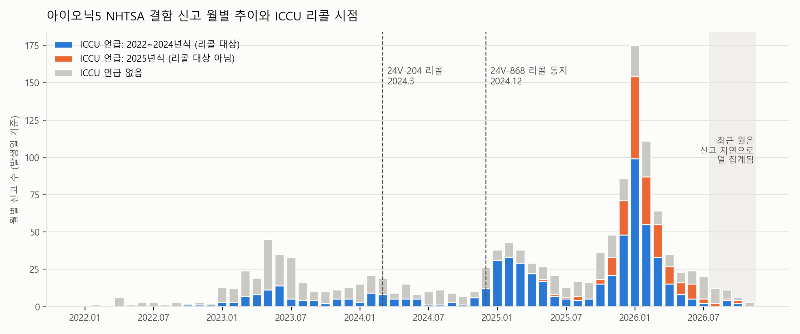

# 아이오닉5 공개 결함 신고 분석과 증상별 점검 순서표

> 개인 프로젝트, 2026-11. 미국 NHTSA에 공개된 소비자 결함 신고를 분류한 결과입니다. 신고는 소비자가 쓴 글이라 **원인이 확인된 정비 기록이 아니며**, 점검 순서표는 현장에서 검증해야 할 가설입니다.

## 1. 데이터
| 항목 | 값 |
|---|---|
| 출처 | api.nhtsa.gov 결함 신고 complaintsByVehicle, 리콜 recallsByVehicle |
| 대상 | 현대 아이오닉5 2022~2025년식 |
| 신고 수 | 1,325건: 2022년식 407, 2023년식 389, 2024년식 226, 2025년식 303 |
| 받은 날 | 2026-11-16 |

## 2. 분류 방법
신고 본문에서 키워드 규칙으로 증상을 찾았습니다. 한 신고에 여러 증상이 있으면 대표 증상 하나를 정했습니다. 우선순위는 ICCU, 12V 방전, 주행 중 출력 저하, 충전 불가, ADAS, 제동, 경고등 순입니다. 규칙은 `scripts/analyze.py`에 있습니다.

## 3. 결과

### 3.1 대표 증상
| 대표 증상 | 건수 | 비율 |
|---|---:|---:|
| ICCU 고장 언급 | 785 | 59% |
| 기타: 후방 와이퍼, 타이어, 배터리 일반 등 | 210 | 16% |
| 제동·급가속 의심 | 72 | 5% |
| 충전 불가 | 66 | 5% |
| 12V 배터리 방전 | 65 | 5% |
| 주행 중 출력 저하·정지 | 62 | 5% |
| ADAS 오작동 | 36 | 3% |
| 경고등만 | 29 | 2% |

### 3.2 ICCU 신고 785건의 특징
ICCU는 통합 충전 제어기로, 고전압 배터리에서 12V 배터리를 충전하는 역할도 합니다.

| 항목 | 건수 |
|---|---:|
| 주행 중 발생 언급 | 197 |
| 출력 저하·정지 언급 | 251 |
| 12V 배터리 언급 | 192 |
| 펑 소리 등 소음 언급 | 167 |
| 소음과 경고 문구를 함께 언급 | 47 |
| 리콜·수리 후 재발 언급 | 53 |

- **자주 나온 경고 문구:**
  - "Check Electric Vehicle System" 79건
  - "Stop Vehicle and Check Power Supply" 74건
  - 출력 제한·거북이 모드 58건
- **자주 나온 고장 코드:**
  - 전체 신고에서 P1A9096이 35건으로 가장 많았습니다. 제조사 고유 코드라 의미는 정비 자료로 확인해야 합니다.
  - P0562 계열인 시스템 전압 낮음도 나왔습니다.
- **주행거리:**
  - 주행거리를 적은 ICCU 신고는 90건뿐입니다.
  - 중앙값은 약 7,900마일, 약 12,700km입니다. 비교적 초기에 발생했다는 신고가 많습니다.
- **연식별 ICCU 언급:**
  - 2022년식 225건, 2023년식 217건, 2024년식 152건, 2025년식 191건입니다.
  - ICCU 리콜 24V-868은 아이오닉5 **2022~2024년식**이 대상입니다. 리콜 대상이 아닌 2025년식에서도 ICCU 언급 신고가 191건 있습니다.

### 3.3 관련 리콜
| 리콜 번호 | 내용 | 조치 |
|---|---|---|
| 24V-204 → 24V-868 | ICCU 손상으로 12V 충전이 멈춰 구동력 상실 가능 | ICCU와 퓨즈 점검·교체, ICCU 소프트웨어 업데이트. 24V-204 수리 차량도 재조치 |
| 26V-432 | 2023~2024년식 고전압 배터리 셀 전극 정렬 불량 | 리콜 원문 참조 |
| 25V-482, 26V-068 | 2025년식 이후 고전압 배터리 버스바 체결 불량 | 리콜 원문 참조 |

### 3.4 분류 정확도 (무작위 표본 100건)
무작위로 고른 100건의 본문을 전부 읽고 규칙 분류와 비교했습니다. 판정 기록은 `labels/review_labels.csv`에, 계산은 `scripts/review_labels.py`에 있습니다.

| 범주 | 규칙 | 판정 | 정밀도 | 재현율 |
|---|---:|---:|---:|---:|
| ICCU 고장 언급 | 65 | 65 | 1.00 | 1.00 |
| 주행 중 출력 저하·정지 | 4 | 11 | 1.00 | 0.36 |
| ADAS 오작동 | 3 | 6 | 1.00 | 0.50 |
| 충전 불가 | 2 | 3 | 1.00 | 0.67 |
| 12V 배터리 방전 | 4 | 4 | 1.00 | 1.00 |
| 제동 | 4 | 4 | 1.00 | 1.00 |
| 경고등만 | 3 | 1 | 0.00 | 0.00 |
| 기타 | 15 | 6 | 0.40 | 1.00 |

- **대표 증상 일치율 88%.** 틀린 12건은 모두 "기타"나 "경고등만"으로 빠진 경우입니다.
- **ICCU 언급은 표본에서 빠짐없이 정확히 잡혔습니다.**
- **약점은 출력 저하 표현입니다.** "27mph 이상 안 나감", "10mph로 느려짐"처럼 속도로 표현한 신고를 규칙이 놓쳤습니다. 운전자 주의 경고 같은 ADAS 오작동도 일부 놓쳤습니다.
- **ICCU를 명시하지 않았지만 같은 패턴인 신고가 11건 있었습니다.** 경고 문구 뒤 출력이 제한되거나 펑 소리가 난 경우입니다. 따라서 ICCU 언급 59%는 ICCU 관련 고장의 **하한에 가까운 값**으로 보는 것이 맞습니다. 다만 이 11건은 원인이 확인되지 않았으므로 ICCU로 세지 않았습니다.
- 규칙을 같은 표본에 맞춰 고치면 정확도가 부풀려지므로, 규칙 수정은 하지 않았습니다. 수정한다면 새 표본으로 다시 측정해야 합니다.

### 3.5 월별 추이와 리콜 시점 (발생일 기준, 1,322건)


| 기간 | 개월 | 리콜 대상 연식 ICCU 언급 | 월평균 |
|---|---:|---:|---:|
| 첫 리콜 24V-204 이전: 2023.01~2024.03 | 15 | 91 | 6.1 |
| 두 리콜 사이: 2024.04~2024.12 | 9 | 39 | 4.3 |
| 확대 리콜 24V-868 통지 이후: 2025.01~2026.09 | 21 | 458 | 21.8 |

- **리콜 이후 ICCU 언급 신고가 줄지 않았습니다.** 리콜 대상인 2022~2024년식에서도 통지 이후 월평균이 이전보다 3배 이상 많습니다. 최대치는 2026년 1월입니다.
- **리콜 대상이 아닌 2025년식의 ICCU 언급은 2025년 말부터 늘었습니다.** 2025년 12월~2026년 3월 넉 달에만 132건입니다.
- **겨울에 몰립니다.** ICCU 언급 신고의 65%가 12~3월에 발생했고, ICCU 언급이 없는 신고는 35%입니다. 겨울별 ICCU 언급은 14건, 25건, 105건, 367건으로 해마다 늘었습니다.
- **그러나 추위가 원인이라고 말할 수는 없습니다.** 본문에 추위나 눈을 언급한 비율은 ICCU 신고와 다른 신고가 4.1%로 같았습니다.

**해석할 때 주의할 점**
- 운행 대수가 늘고 차가 오래될수록 신고는 자연히 늘어납니다. 이 데이터에는 운행 대수가 없어 고장률을 계산할 수 없습니다.
- 언론 보도나 온라인 커뮤니티가 신고를 늘렸을 수 있습니다.
- 신고 차량이 리콜 조치를 받았는지는 대부분 알 수 없습니다. 리콜 후 재발을 직접 언급한 신고는 3단계에서 따로 봅니다.
- 신고는 발생 뒤 중앙값 10일 뒤에 접수되므로, 최근 두세 달은 덜 집계됐습니다.

### 3.6 리콜·수리 후 재발 신고 (3단계)
ICCU 언급 신고 785건 중 리콜, 소프트웨어 업데이트, 교체, 재발을 뜻하는 표현이 있는 239건을 뽑아 본문을 모두 읽고 판정했습니다. 판정 기록은 `labels/recurrence_labels.csv`, 기준은 `scripts/recurrence_labels.py`에 있습니다.

| 판정 | 건수 | 뜻 |
|---|---:|---|
| ICCU 교체 후 재고장 | 52 | 이미 한 번 교체한 ICCU가 다시 고장 |
| 리콜·소프트웨어 조치 후 고장 | 105 | 리콜 업데이트나 점검을 받은 뒤 고장, 이전 교체 언급 없음 |
| 불분명 | 10 | 재발로 보이나 서술이 모호 |
| 재발 아님 | 71 | 리콜 미이행, 같은 사건 안의 반복, 앞으로의 걱정 등 |
| 중복 신고 | 1 | 같은 신고자로 보여 제외 |

- **ICCU 언급 신고의 20%인 157건이 조치를 받은 뒤의 고장을 서술합니다.**
- **조치 뒤 재고장까지 기간을 적은 신고만 보면:**
  - 소프트웨어 조치 후 고장 21건: 중앙값 약 30일, 11건이 30일 이내였습니다. 같은 날이나 이틀 뒤라고 쓴 신고도 있습니다.
  - ICCU 교체 후 재고장 11건: 중앙값 약 8개월, 짧게는 하루, 길게는 16개월이었습니다.
- **리콜 대상이 아닌 2025년식에서도 교체 후 재고장 서술이 5건 있었습니다.**

**해석할 때 주의할 점**
- 조치 직후에 고장 난 사람일수록 "리콜을 받았는데도"라고 쓸 가능성이 커서, 짧은 기간이 과대 대표됐을 수 있습니다.
- 기간을 적은 신고는 32건뿐입니다.
- 소프트웨어 조치와 고장 사이의 인과는 이 데이터로 판단할 수 없습니다.
- 판정은 한 번만 했고, 다른 사람의 교차 검토는 거치지 않았습니다.

## 4. 증상별 점검 순서표 (가설)

### A. "Check Electric Vehicle System" 경고, 출력 제한, 펑 소리
1. **문진:** 소리가 났는지, 어떤 경고 문구였는지, 주행 중이었는지 정차·시동 중이었는지, 충전 중이었는지 확인
2. **VIN으로 리콜 이행 여부 조회:** 24V-868 미이행이면 리콜 조치부터
3. **12V 배터리 전압 측정:** 낮으면 ICCU가 12V를 충전하지 못하는 상태인지 의심
4. **고장 코드 조회:** P1A9096, 시스템 전압 낮음 계열 코드 확인
5. **ICCU 퓨즈 단선 확인, ICCU 점검:** 리콜 조치 기준에 따라 교체와 소프트웨어 업데이트
6. **조치 이력이 있는 차량이면 날짜까지 기록:** 마지막 리콜·업데이트일, ICCU 교체일, 주행거리, 고장 코드를 품질 부서에 공유. 신고에서 조치 뒤 한 달 안의 재고장 서술이 많았으므로, 문진에서 최근 조치 날짜를 먼저 묻는다

### B. 시동 불가, 차량 완전 방전
1. **문진:** 경고 없이 방전됐는지, 최근 ICCU 관련 경고가 있었는지
2. **12V 배터리 상태 점검:** 배터리 자체 열화인지, 충전이 안 된 것인지 구분
3. **12V가 정상 충전되지 않으면 A의 3~5단계로**
4. **12V만 교체한 이력이 반복되면** 단순 배터리 문제가 아닐 가능성을 염두

### C. 충전이 중간에 멈춤
1. **문진:** 완속인지 급속인지, 충전 전류, 충전 포트 발열 여부
2. **ICCU 언급이나 경고 문구가 있으면** A로
3. **완속 고전류에서만 멈추면** 충전 포트·케이블 발열 점검. 신고에 32A 초과 시 중단 사례가 있음

## 5. 한계
- 신고는 소비자 서술이라 진단이 확인되지 않은 경우가 섞여 있고, 같은 사람이 여러 번 신고했을 수도 있습니다.
- 키워드 규칙이라 오타가 있으면 놓칩니다. 예를 들어 "Intergrated"로 쓴 신고는 ICCU로 잡히지 않았습니다. 무작위 표본을 읽어 대체로 맞는 것은 확인했지만, 정밀도를 정량적으로 측정하지는 않았습니다.
- 미국 신고 데이터라 국내 운행 환경과 다를 수 있습니다.
- 점검 순서표는 신고 패턴과 리콜 조치 내용으로 만든 가설입니다. 실제 정비 매뉴얼과 현장 데이터로 검증해야 합니다.

## 6. 재현
```bash
pip install -r requirements.txt
python scripts/fetch_data.py             # NHTSA API에서 신고·리콜 받기 → data/
python scripts/analyze.py                # 키워드 분류 → results/summary.json
python scripts/review_labels.py          # 표본 100건 판정과 비교 → results/review_metrics.json
python scripts/trend.py                  # 월별 추이 → results/trend_summary.json, 그림
python scripts/recurrence_candidates.py  # 재발 후보 추출
python scripts/recurrence_labels.py      # 재발 판정 요약 → results/recurrence_summary.json
```

| 폴더 | 내용 |
|---|---|
| `labels/` | 사람이 본문을 읽고 남긴 판정. 신고 번호(odi) 기준 |
| `results/` | 요약 JSON과 그림. 신고 본문이 들어간 중간 CSV는 저장소에 올리지 않음 |
| `docs/plan.md` | 계획서와 진행 기록 |

NHTSA 데이터는 계속 쌓이므로, 다시 받으면 건수가 이 문서와 달라질 수 있습니다. 이 문서의 수치는 2026-11-16에 받은 데이터 기준입니다.
